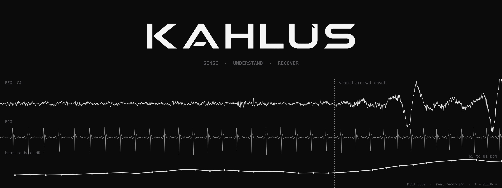
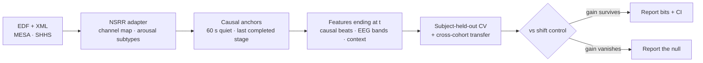

<div align="center">

<picture>
  <source media="(prefers-color-scheme: dark)" srcset="docs/assets/kahlus-wordmark-light.png">
  
</picture>

<p><strong>Leakage-controlled neural-state forecasting.</strong><br>
Can noninvasive biosignals predict what the brain does next, under honest held-out splits?</p>

[](https://github.com/Kahlus-Technologies)
[](https://github.com/Kahlus-Technologies/Kahlus-V1/commits)
[](pyproject.toml)
[](https://sleepdata.org)
[](AGENTS.md)



<sub>One real night (MESA 0002). EEG arousal at the dashed line, heart rate climbs 65 → 81 bpm. Rendered by <code>scripts/make_readme_hero.py</code>.</sub>

</div>

---

<div align="center">

## What this is

</div>

Kahlus asks one falsifiable question:

> **Do noninvasive recordings carry information about *future* neural state that survives strict subject, site and dataset holdout?**

Most neural forecasting numbers in the literature leak: overlapping windows, reused subjects, scores computed with the future in hand. Kahlus is built to make that impossible, then report whatever is left, including losses.

- **Split first.** The split manifest is frozen before preprocessing, windowing or augmentation.
- **Causal everything.** Features end at the prediction time. Beat detection, quality masks and normalizers only read the past, and tests prove it.
- **Controls, not vibes.** Every gain is checked against a time-shifted copy of the same features. If the shifted copy gains too, it was the person, not the signal.
- **Losses are results.** If a ridge baseline wins, that goes in the table.

The full research constitution and claim boundaries live in **[AGENTS.md](AGENTS.md)**.

---

<div align="center">

## Results so far

</div>

> Every number below is a dev slice (25 MESA + 25 SHHS nights, smoke bootstrap). None is a claim until the full-cohort run.

| study | question | where it stands |
| --- | --- | --- |
| **Heart-only arousal forecasting** · [#83](https://github.com/Kahlus-Technologies/Kahlus-V1/issues/83) | does ECG predict a spontaneous arousal 5–120 s ahead, beyond time-since-last-arousal and sleep stage? | **unresolved** · 5/20 cells above zero after review fixes, sign moved with each fix |
| **Beat-level warning** · [#83](https://github.com/Kahlus-Technologies/Kahlus-V1/issues/83) | do the last 5 heartbeats warn 1–5 s ahead? | **small, consistent** · 16/16 cells positive, 8 clear zero, ~1% of label entropy |
| **Conformal alarm budget** · [#89](https://github.com/Kahlus-Technologies/Kahlus-V1/issues/89) | can a threshold guarantee a miss rate on new people? | **works on average** · per-person miss rate spreads 0.07–0.36 |
| **Closed-loop stimulation veto** · [#96](https://github.com/Kahlus-Technologies/Kahlus-V1/issues/96) | can a forecast hold back clicks that land right before an arousal? | **yes, from context** · ~2× better than random, heart adds a little on SHHS only |
| **Low-cost headband stress test** · [#97](https://github.com/Kahlus-Technologies/Kahlus-V1/issues/97) | how much does dry-electrode noise cost arousal detection? | **about half** · event F1 0.20–0.25 clean → 0.10–0.13 dry headband |

Write-ups: [`docs/results/`](docs/results/) · earlier findings F0–F9: [`findings-ledger.md`](docs/results/findings-ledger.md)

<details>
<summary><b>Earlier v1 headline (EEG neural translation)</b></summary>

On recovered EEG v1 sidecars the honest finding is a **split verdict**, and an overlap audit later showed the forecasting number was inflated by input–target overlap. Under isolated, strictly-future evaluation on Sleep-EDF and BNCI2014_001, the Kahlus GRU does **not** beat the best trivial baseline.

| task / audit | honest status | note |
| --- | --- | --- |
| **Masked reconstruction** | **lose to ridge** | aggregate reconstruction failed (see A100 ledger) |
| **Isolated future-sample forecast** | **lose to persistence / ridge** | Sleep-EDF + BNCI subject-held-out |
| **Overlapping forecast sidecar (legacy)** | not a whole-model claim | 3.116 MSE / 0.972 r is a narrow, overlap-contaminated sidecar only |

Do **not** headline 3.116 MSE / 0.972 Pearson as whole-model performance.


Powered Passive PCI on the full Sleep-EDF cassette (F4): the complexity block **hurts** prediction vs a spectral baseline, wake RFS **−0.330** bits (CI excludes 0).

Papers: [NeurIPS 2026 packet](docs/paper/neurips_2026/) · [Neural-CASP arena](docs/paper/neural_casp_arena/) · figure provenance: [`eeg_v1_figure_source/`](docs/research/eeg_v1_figure_source/)

</details>

---

<div align="center">

## Quickstart

</div>

```bash
git clone https://github.com/Kahlus-Technologies/Kahlus-V1.git && cd Kahlus-V1
python -m venv .venv && source .venv/bin/activate
pip install -e '.[nsrr,dev]'          # add ,moabb for MOABB EEG adapters
python -m pytest -q tests/adapters tests/forecastability
```

**NSRR studies** (needs [sleepdata.org](https://sleepdata.org) access, token in `~/.nsrr_token`):

```bash
scripts/nsrr_fetch_slice.sh                       # all MESA + SHHS1 annotations + 25 EDFs each (~7 GB)
scripts/repro_dev_slice.sh runs/dev ~/data/nsrr/mesa ~/data/nsrr/shhs   # every study, ~30 min on a laptop
```

**Cluster** (A100, full cohorts):

```bash
pip install -e '.[cluster]'
scripts/cluster/chapman_a100_first_run.sh /path/to/shared/persistent/neurotwin
```

---

<div align="center">

## How it works

</div>



| piece | file |
| --- | --- |
| NSRR loading, arousal subtypes, montage | `src/neurotwin/adapters/nsrr.py` |
| Causal QRS detector + beat-quality mask | `src/neurotwin/adapters/qrs_fast.py` |
| Anchors, labels, features, shift control, model | `src/neurotwin/forecastability/heart_arousal.py` |
| Conformal alarms · CLAS replay · headband degradation | `src/neurotwin/forecastability/{conformal,clas_replay,montage_degrade}.py` |
| Study runners | `scripts/run_*.py` |
| Reproduce everything / prove a refactor changed nothing | `scripts/repro_dev_slice.sh` · `scripts/check_artifacts_unchanged.sh` |

<details>
<summary><b>v1 scaffold: NeuroTwin NFC, split manifests, CLI</b></summary>

- Shared `NeuralEventBatch` schema for fMRI, EEG, MEG, spikes, behavior, stimulus, anatomy and clinical metadata.
- `SplitManifest` built at recording-manifest time, before preprocessing, windowing or augmentation.
- Leakage checks for record reuse, held-out group overlap, repeated windows and forbidden target metadata.
- Five v1 task families scored under held-out splits: future-state forecasting, masked reconstruction, cross-modal translation, subject adaptation, dataset/site generalization. Baseline failures are explicit and excluded from rankings.
- Competitor registry that names the crowded lanes (TRIBE, BrainVista, Brain-OF, BrainOmni, Brain Harmony) instead of pretending they do not exist.
- NeuroTwin NFC (Neural Field Compiler): every modality is a partial observation of one latent neural field. Synthetic NFC outputs are plumbing checks, not science.
- Prepared-manifest training with DDP under `torchrun`, checkpoint resume, bf16, config snapshots and split hashes. A100 is the canonical target (`configs/train/*_a100.yaml`, `docs/deploy/A100_RUNBOOK.md`).
- Directed-information estimators are checked separately by [kahlus-bench](https://github.com/ptlnextdoor/kahlus-bench), which certifies estimators against synthetic systems with analytically known ground truth.

```bash
nt doctor
nt data prepare --dataset synthetic --split subject
nt data smoke   --dataset moabb --split subject --out-dir /tmp/neurotwin_moabb_smoke
nt split audit  --dataset synthetic --split subject
nt train --dry-run --config configs/train/neurotwin_v1_a100.yaml
nt eval  --suite neural_translation_v1 --event-manifest <prepared>/event_manifest.json --split-manifest <prepared>/split_manifest.json
nt report --compare runs/<a> runs/<b> --out-dir reports/compare
```

Full local verification:

```bash
PYTHONPATH=src python3 -m unittest discover -s tests -v
PYTHONPATH=src python3 -m neurotwin.cli eval --suite nfc_synthetic --out-dir /tmp/neurotwin_nfc_synthetic --train-steps 1 --seed 0
bash -n scripts/slurm/*.sh
```

</details>

---

<div align="center">

## Scope and safety

</div>

- **Not a medical device.** No clinical, diagnostic or "digital twin" claims. See [AGENTS.md](AGENTS.md).
- **Dev-slice numbers are not claims.** Claims need the full cohort, claim-mode bootstrap (2,000 resamples) and multiplicity control.
- **No human stimulation** without engineering validation, informed consent, safety review and applicable regulatory review.
- **Raw data is never committed.** The repo stores manifests, configs, adapters, download scripts and cached JSON results. NSRR data requires your own credentialed access.

<div align="center">

<br>

<sub>Built by <a href="https://github.com/Kahlus-Technologies">Kahlus Technologies</a> · Sense · Understand · Recover</sub>

</div>
